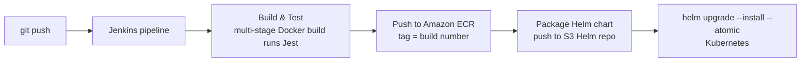

# CI-CD-Template

A complete Jenkins → Amazon ECR → Helm → Kubernetes delivery pipeline for a small Node.js to-do application. It is meant as a starting template for teams that run Jenkins and want a simple, scriptable path from commit to a running release.



## Pipeline

| Stage | Script | What happens |
|---|---|---|
| Build & Test | [`build-image.sh`](build-image.sh) | Multi-stage Docker build; unit tests run in the build stage, so a red test means no image |
| Push to ECR | [`push-image.sh`](push-image.sh) | Logs in with `aws ecr get-login-password` and pushes an immutable tag (`$BUILD_NUMBER`) |
| Deploy with Helm | [`deploy-app.sh`](deploy-app.sh) | Renders build-specific values with `envsubst`, versions and pushes the chart to an S3 Helm repo (helm-s3), then `helm upgrade --install --atomic --wait`. A failed rollout is rolled back automatically |

The [`Jenkinsfile`](Jenkinsfile) wires these together, only deploys from `main`, prevents concurrent builds and cleans up local images after every run.

## Repository layout

```
src/, spec/              Node.js app (Express, SQLite or MySQL persistence) and Jest tests
Dockerfile               test stage + slim non-root runtime stage
Jenkinsfile              declarative pipeline
*.sh                     build / push / deploy steps (usable outside Jenkins too)
k8s/todo_chart/          Helm chart: Deployment with probes and resources, Service
.github/workflows/ci.yml GitHub Actions: tests, helm lint, image build
```

## Running locally

```bash
npm ci && npm test
docker build -t todo-app:dev .
docker run -p 3000:3000 todo-app:dev      # http://localhost:3000
helm template demo k8s/todo_chart
```

## Jenkins prerequisites

- Agent with Docker, AWS CLI v2, Helm 3 + [helm-s3](https://github.com/hypnoglow/helm-s3) plugin, `kubectl` and `envsubst`.
- An IAM role (instance profile or IRSA) with ECR push, S3 access to the chart bucket and EKS access.
- An ECR repository named `todo-app` and an S3 bucket for charts (`HELM_S3_REPO`).

## Notes

The application code comes from Docker's public *getting-started* sample. The pipeline, Dockerfile, chart and scripts are the focus of this repository.
For reusable GitHub Actions / GitLab CI / Bitbucket Pipelines templates with OIDC, image signing and GitOps promotion, see [platform-ci-templates](https://github.com/ozy31/platform-ci-templates).
